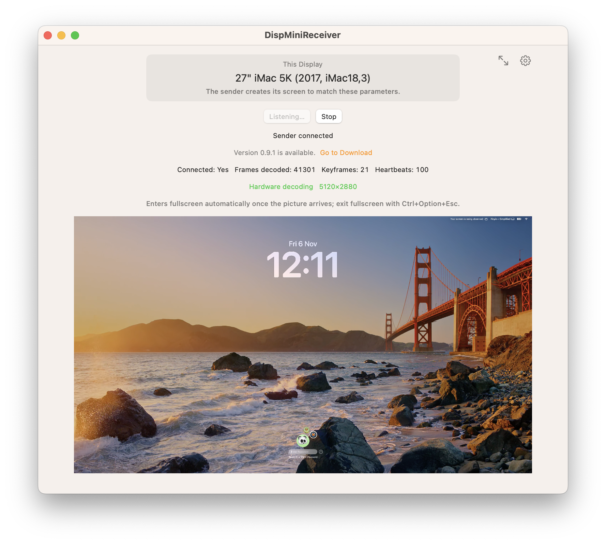
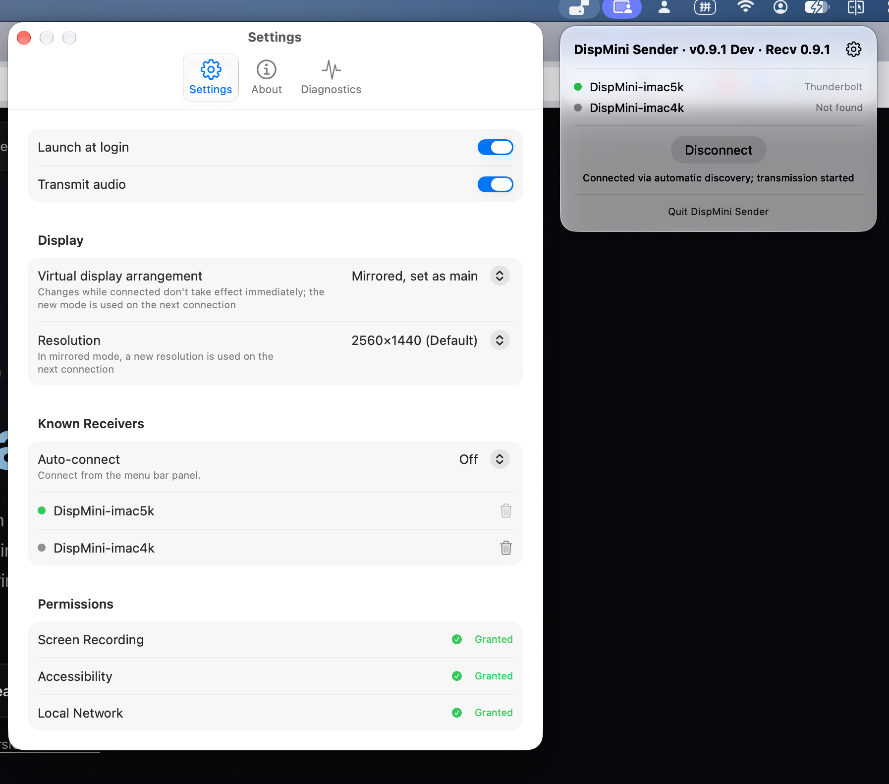
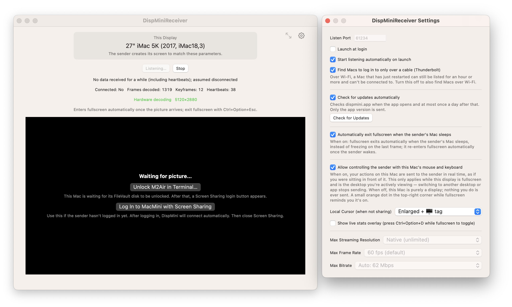

# DispMini

### Use Your 4K or 5K iMac as a Native Monitor for a Mac mini or MacBook

[%20%7C%2014%2B%20(Sender)-000000?style=flat-square&logo=apple)](https://github.com/23900/DispMini/releases)

**[Download](https://github.com/23900/DispMini/releases)** · **[Setup Guide](https://dispmini.app/setup-guide)** · **[FAQ](docs/faq.md)** · **[Troubleshooting](https://dispmini.app/troubleshooting)** · **[Website](https://dispmini.app)** · **[❤️ Sponsor](https://buymeacoffee.com/dispmini)**

---

**DispMini** is a native macOS app that turns a **2017-or-later iMac** into an external display for an **Apple silicon Mac mini, Mac Studio, or MacBook**. Built as a modern alternative to Apple's discontinued Target Display Mode, it streams over a direct **Thunderbolt or USB4 cable** with hardware-accelerated video, audio, and keyboard/mouse sharing.

Your iMac may be stuck on an older version of macOS, but its 4K or 5K Retina panel is still extraordinary. **Keep the screen, and let your Apple silicon Mac do the work.**

> ⭐ **Like this project?** If DispMini gives your iMac a second life, please consider **[starring this repository](https://github.com/23900/DispMini)** on GitHub so more iMac and Mac mini owners can discover it!

  
   
  <b>DispMiniReceiver on a 27" iMac 5K (2017):</b> Native <code>5120×2880</code> hardware decoding over Thunderbolt (automatically enters fullscreen once connected).

> [!NOTE]
> Free for personal, educational, non-profit, and government use. This repository hosts documentation, issue tracking, and release downloads; the source code isn't published here.

## Why DispMini

- **Pixel-perfect 4K & 5K text:** The virtual display on your Mac mini matches the iMac's exact Retina dimensions (`5120×2880` on 27" 5K, `4096×2304` on 21.5" 4K) with native HiDPI scaling—nothing is stretched or softened.
- **Smooth, cool, and quiet:** Both Macs use their built-in Apple Media Engine / Intel Quick Sync hardware encoders and decoders at up to 60 fps.
- **Plug-and-play automatic connection:** Set both apps to launch at login and DispMini connects on its own over Thunderbolt—even adapting when your Mac mini sleeps or wakes.
- **Built for headless Mac minis:** No HDMI dummy plug needed. Includes built-in helpers to unlock a FileVault disk over Thunderbolt and log in via Screen Sharing after a reboot.
- **One keyboard and mouse:** Optionally control the Mac mini directly from the iMac's mouse, trackpad, and keyboard.
- **Audio included:** Routes your Mac mini's system sound straight through the iMac's built-in stereo speakers.
- **Still a full iMac when you need it:** Swipe Spaces or press `Ctrl+Option+Esc` to return to the iMac's own desktop at any time.
- **100% local, zero cloud:** Video, audio, and input travel directly between your two Macs over the cable and are never uploaded.

## Screenshots & Interface

### 1. Menu Bar & Sender Settings (Mac mini / MacBook / Mac Studio)

**DispMiniSender** lives quietly in your menu bar. It automatically discovers your iMac over Thunderbolt, configures a native HiDPI virtual display, forwards system audio, and shows permission status at a glance.

  

### 2. Receiver Settings & Headless Reboot Recovery (iMac)

**DispMiniReceiver** listens automatically on launch, switches into and out of fullscreen as your sender Mac wakes or sleeps, forwards your iMac's keyboard and mouse, and provides one-click shortcuts to unlock FileVault or log in after a Mac mini restart.

  

## Requirements

| App | Install on | Minimum OS |
|---|---|---|
| **DispMiniSender** | Mac mini, Mac Studio, or MacBook with **Apple silicon** (M1 / M2 / M3 / M4) | macOS 14 Sonoma or later |
| **DispMiniReceiver** | iMac from **2017 or later** | macOS 13 Ventura or later |

You also need a **Thunderbolt 3 / 4 or USB4 data cable** between the two Macs for full 4K/5K 60 fps performance (manual Wi-Fi connection is also supported as a fallback).

The **21.5-inch iMac 4K (2017)** and **27-inch iMac 5K (2017)** are tested on real hardware.

## Quick Start

1. **Connect** the two Macs directly with a Thunderbolt 3/4 or USB4 cable.
2. **Launch** `DispMiniReceiver` on the iMac and `DispMiniSender` on the Mac mini.
3. **Grant** the permissions macOS prompts for (Screen Recording, Local Network, and optional Accessibility for keyboard/mouse control).

Your iMac immediately becomes your Mac mini's display and enters fullscreen automatically. See the full **[Setup Guide](https://dispmini.app/setup-guide)** for headless setup, auto-login, and daily tips.

## Network & Privacy

All video, audio, and input data streams directly between your Macs over the local connection—nothing is sent to external servers or the cloud.

To maximize streaming performance and eliminate latency, DispMini does not add application-level encryption on top of the stream. While your Wi-Fi network itself provides link-layer encryption (such as WPA2/WPA3), we recommend using a direct Thunderbolt/USB4 cable or a trusted private home/office network rather than public Wi-Fi.

Update checks send basic device info and anonymous region metadata to verify latest versions. See the [Privacy Policy](PRIVACY.md).

## Support & License

DispMini is **free for individuals (including freelancers), schools, non-profits, and government bodies**, with no ads, watermarks, or subscriptions.

- ⭐ **Star on GitHub:** Click **Star** at the top right of this page to help others repurpose their 4K and 5K iMacs instead of replacing them.
- ☕ **Sponsor Development:** If DispMini saved you the cost of a new 5K monitor, consider **[buying me a coffee](https://buymeacoffee.com/dispmini)** to help cover Apple Developer membership costs and ongoing macOS compatibility.
- 🏢 **Commercial Use:** Companies and other businesses need a separate commercial agreement—email [support@dispmini.app](mailto:support@dispmini.app). DispMini isn't open source; see the [license agreement](LICENSE.md).

---

  DispMini is an independent project and isn't affiliated with Apple. Mac, iMac, Mac mini, Mac Studio, and MacBook are trademarks of Apple Inc.

