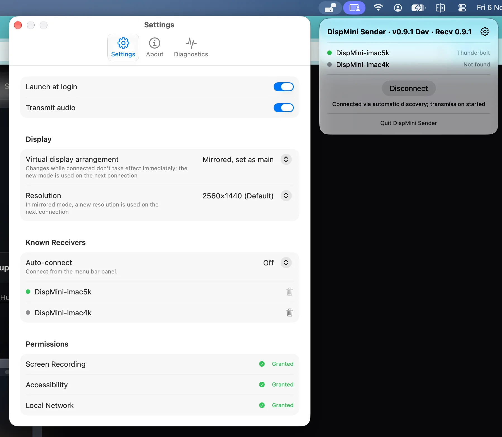
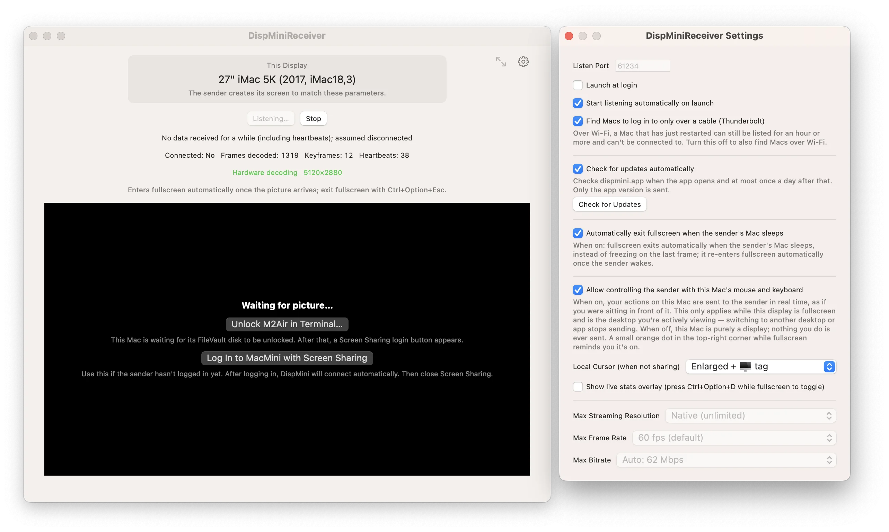

# DispMini

### Turn your iMac into your Mac mini's display

*Your 5K iMac stopped receiving macOS updates. That screen never stopped being excellent.* 
*Your Mac mini brings the power, the iMac brings the screen.*

[-000000?style=flat-square&logo=apple)](https://dispmini.app/#specs)
[-6fb6e6?style=flat-square&logo=apple)](https://dispmini.app/imac-as-monitor)

**[⬇️ Download Sender](https://dispmini.app/download/sender)** · **[⬇️ Download Receiver](https://dispmini.app/download/receiver)** · **[All Releases](https://github.com/23900/DispMini/releases)** 
**[Setup Guide](https://dispmini.app/setup-guide)** · **[FAQ](docs/faq.md)** · **[Troubleshooting](https://dispmini.app/troubleshooting)** · **[Website](https://dispmini.app)** · **[❤️ Sponsor](https://buymeacoffee.com/dispmini)**

---

**DispMini** is a pair of native macOS apps that turn a **2017-or-later iMac** into an external monitor for an **Apple silicon Mac mini, MacBook, or Mac Studio** over a direct **Thunderbolt 3/4 or USB4 cable** — a modern replacement for Apple's discontinued [Target Display Mode](https://dispmini.app/target-display-mode-alternative).

> ⭐ **Put that screen back to work!** A perfectly good 4K or 5K Retina panel sitting idle is a waste worth fixing. If DispMini saves your iMac from retirement, please **[give this repo a Star ⭐](https://github.com/23900/DispMini)** so more Mac owners can find it!

  
   
  <b>DispMiniReceiver on a 27" iMac 5K (2017):</b> Generating a pixel-accurate <code>5120×2880</code> picture with hardware decoding over Thunderbolt (enters fullscreen automatically once the picture arrives).

## Two Gaps That Complete Each Other

| 🖥️ **Mac mini is powerful — with no screen** | 🍏 **Your iMac's screen is great — its software isn't** |
| :--- | :--- |
| Great M-series performance, but headless by design — and a 4K/5K display that does it justice isn't cheap. | Apple stopped pushing macOS updates to [Intel-era iMacs](https://dispmini.app/intel-imac-after-macos-support), but that 4K/5K panel is still first-rate. |

**DispMini connects the two for the price of a cable — neither machine has to be retired.**

> [!NOTE]
> DispMini is **free for individuals (including freelancers), schools, non-profits, and government bodies**. This repository hosts documentation, issue tracking, and release downloads; the source code isn't published here.

## Close to a Real, Wired Display

- **Pixel-accurate 4K & 5K (HiDPI):** The picture is generated to match the iMac's real physical dimensions (`5120×2880` on 27" 5K, `4096×2304` on 21.5" 4K) — sharp Retina text, not a scaled, softened mirror. Stay on the default size or pick *More Space* in HiDPI.
- **Hardware encode & decode:** Both ends use the Mac's built-in video engines at up to 60 fps — smooth, without spinning up the fans.
- **Extended, main display, or mirrored:** Use the iMac as an extended second display beside a MacBook's own screen, make it the primary display for a Mac mini, or mirror.
- **Reconnects on its own:** Once both apps start at login, they find each other and reconnect automatically over Thunderbolt — no one needs to babysit the Mac mini.
- **Headless Mac mini friendly (no HDMI dummy plug):** After initial setup, your Mac mini needs no monitor attached. Includes built-in helpers to [unlock FileVault over the Thunderbolt cable](https://dispmini.app/login-after-restart#if-filevault-is-on) and [log in with Screen Sharing](https://dispmini.app/login-after-restart) after a restart.
- **One keyboard & mouse for both:** Optionally drive the Mac mini with the iMac's own keyboard, mouse, or trackpad.
- **Sound through the iMac:** Audio travels with the picture (`Transmit audio` is on by default), playing through the iMac's built-in speakers.
- **Switch back anytime:** DispMini lives on its own desktop Space on the iMac — swipe or press `Ctrl+Option+Esc` to return to the iMac's own desktop whenever you like.

## Screenshots & Interface

### 1. Menu Bar & Sender Settings (Mac mini / MacBook / Mac Studio)

**DispMiniSender** lives quietly in the menu bar. Each paired receiver shows a live connection dot — **green** means it's on the Thunderbolt cable and fully tuned (`Aim for green`), **yellow** means on the cable, and **red** means over Wi-Fi.

  

### 2. Receiver Settings & Headless Reboot Recovery (iMac)

**DispMiniReceiver** listens automatically on launch, exits and re-enters fullscreen when your sender Mac sleeps or wakes, forwards your iMac's mouse and keyboard, and provides one-click actions to unlock a FileVault disk or open Screen Sharing login after your Mac mini restarts.

  

## Requirements

| App | Install on | Requirements |
|---|---|---|
| **DispMiniSender** | **Apple silicon** (M-series) Mac mini, MacBook, or Mac Studio *(Intel senders not supported)* | **macOS 14** or newer |
| **DispMiniReceiver** | **iMac from 2017 or later** (including 2019 & 2020 models) | **macOS 13** or newer |

Plus **one cable**: a **Thunderbolt 3 / 4 or USB4 data cable** directly between the two Macs (a plain USB-C charging cable looks identical but carries no data). Manual Wi-Fi connection is also available as a fallback.

The **21.5" iMac 4K (2017)** and **27" iMac 5K (2017)** are tested on real hardware — see [which iMac models work](https://dispmini.app/imac-as-monitor).

## How It Works (3 Steps)

1. **Wire the two Macs together:** Run a Thunderbolt 3/4 or USB4 cable straight between them. (On an M4 / M4 Pro Mac mini or Max-chip Mac Studio, use the rear Thunderbolt ports.)
2. **Install both apps:** [DispMiniSender](https://dispmini.app/download/sender) on the Mac mini/MacBook, [DispMiniReceiver](https://dispmini.app/download/receiver) on the iMac.
3. **Approve once, start at login:** Allow Screen Recording and Local Network (plus Accessibility on the Mac mini if sharing keyboard & mouse). Set both apps to start at login, and they connect automatically whenever the cable is plugged in.

### Helpful Guides

- 📖 **[Full Setup Guide](https://dispmini.app/setup-guide)** — Step-by-step installation, permissions, and daily shortcuts
- 🔐 **[Log In After a Restart](https://dispmini.app/login-after-restart)** — Running a headless Mac mini (with or without FileVault)
- 🖥️ **[Supported iMac Models](https://dispmini.app/imac-as-monitor)** — Compatibility details for 2017, 2019, and 2020 iMacs
- ⚖️ **[Target Display Mode Alternatives](https://dispmini.app/target-display-mode-alternative)** — How DispMini compares with AirPlay, Luna Display, and Duet
- 🛠️ **[Troubleshooting](https://dispmini.app/troubleshooting)** & **[FAQ](docs/faq.md)** — Connection status dots, audio, and common questions

## Network & Privacy

All video, audio, and input data streams directly peer-to-peer between your two Macs over the local link—nothing is uploaded or relayed through any server.

The two Macs pair once, and keyboard and mouse input then goes over an encrypted connection. To keep latency low, the picture and sound aren't encrypted, so use the direct Thunderbolt/USB4 cable it is built for, or a trusted private home/office network—not public or shared Wi-Fi.

Update checks send basic device info and anonymous region metadata to verify latest versions. See the [Privacy Policy](PRIVACY.md).

## Support & License

DispMini is **free for individuals (including freelancers), schools, non-profits, and government bodies**, with no ads or subscriptions, and is sustained by voluntary sponsorship.

- ⭐ **Star this repo:** If DispMini gave your 4K or 5K iMac a second life, click **Star** at the top right of this page to help more people discover it!
- ☕ **Sponsor the project:** Saved the cost of a new monitor? Consider **[buying me a coffee](https://buymeacoffee.com/dispmini)** to help cover Apple Developer membership costs and ongoing macOS compatibility.
- 🏢 **Commercial licensing:** Companies and other businesses need a separate agreement: email [support@dispmini.app](mailto:support@dispmini.app). DispMini is closed-source — see the [license agreement](LICENSE.md).

---

  © 2026 DispMini. An independent project and isn't affiliated with Apple. Mac, iMac, Mac mini, Mac Studio, and MacBook are trademarks of Apple Inc.

